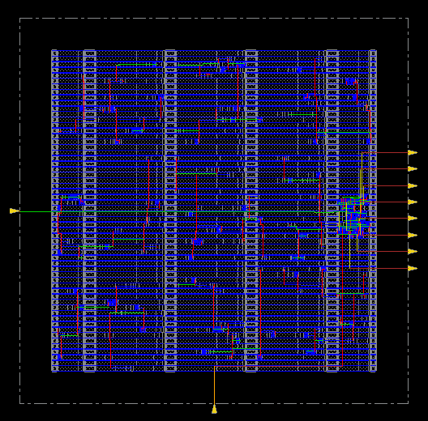
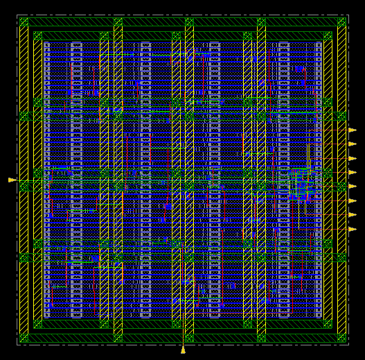
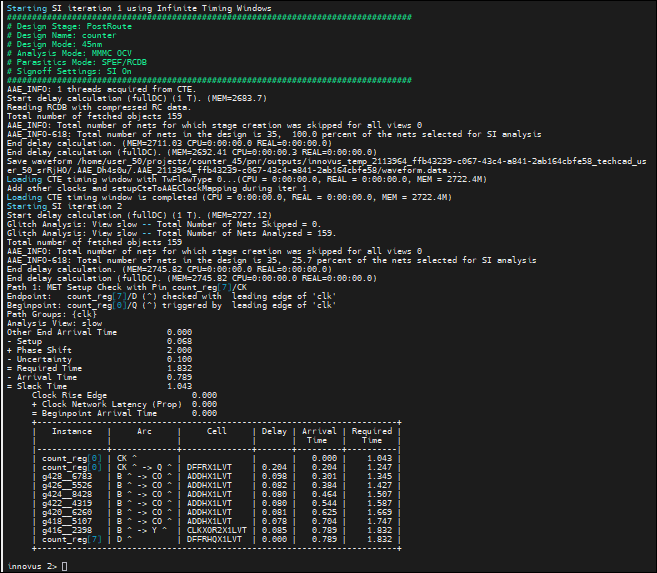

# Synchronous Digital Counter — RTL-to-GDSII Implementation & Physical Verification

An end-to-end ASIC implementation and sign-off physical verification project taking a synchronous `counter` design from RTL to physical layout using **Cadence EDA tools** and the **GPDK45 (45 nm)** technology library.

## Project Overview

This project executes a complete digital **RTL-to-GDSII** ASIC implementation and physical verification flow using a synchronous digital `counter` design.

The implementation targets the **GPDK45 (45 nm Generic Process Design Kit)**, using **Cadence Genus** for logic synthesis, **Cadence Innovus** for physical design, and **Cadence Pegasus** for DRC, ERC, and LVS verification.

The primary objective is to test and refine flow/automation scripts, verify command-line flags and report structures in Cadence tools, and observe how physical verification behaves on a clean, small-scale reference design.

## Design Specifications

| Parameter | Description |
|---|---|
| Design | Synchronous Digital Counter |
| Architecture | 8-bit Synchronous Up Counter |
| Top Module | `counter` |
| RTL Language | Verilog  |
| RTL Source | Custom RTL Design (`counter.v`) |
| Target Technology | GPDK45 (`gsclib045_svt`, `gsclib045_lvt`, `gsclib045_hvt`) |
| Technology Node | 45 nm (Generic PDK) |
| Synthesis Tool | Cadence Genus (`25.10`) |
| Physical Design Tool | Cadence Innovus (`25.10`) |


### 1.1 SDC Requirements
- **Target Frequency:** `500 MHz`
- **Clock Uncertainty:** `0.10 ns` for both Setup and  `0.03 ns` for Hold
- **Clock Transition:** `0.04 ns`

### 1.2 Floorplan & Component Parameters
- **Die Area:** ` 100 x 99.18 um `
- **Margin (Core to Die):** `~10 um`
- **Total Instances:** `1627`
- **Code Utilization:** `3.55%`
- **Core Density:** `67.538%`


### 1.4 Metal Layer Parameters
The design uses 9 metal layers (M1 to M9). The design rules extracted from the LEF file are as follows:

| Metal Layer | Routing Direction | Min Width (um) | Min Space (um) | Pitch (um) |
|---|---|---|---|---|
|Metal1   | horizontal |  0.06   |  0.06   | 0.19
Metal2   | vertical   |  0.08   |  0.07   | 0.2
Metal3   | horizontal | 0.08   |  0.07   | 0.19
Metal4   | vertical   | 0.08   |  0.07   | 0.2
Metal5   | horizontal |  0.08   |  0.07   |  0.19
Metal6   | vertical   | 0.08   |  0.07   |  0.2
Metal7   | horizontal |  0.08   |  0.07   |  0.19
Metal8   | vertical   |  0.08   |  0.07   |  0.2
Metal9   | horizontal |  0.08   |  0.07   |  0.19
Metal10  | vertical   |  0.22   |  0.2    |  0.5
Metal11  | horizontal |  0.22   |  0.2    | 0.475


## Project Gallery

### Physical Design





*Figure: Detailed post-route physical layout.*

### Timing Analysis and Verification




*Figure 5. Overall Verification summary.*


## RTL-to-GDSII Design Flow

```text
           Counter RTL
                |
                v
     RTL Analysis & Elaboration
                |
                v
         Logic Synthesis
         (Cadence Genus)
                |
                v
       Technology Mapping
    (GPDK45 SVT / LVT / HVT)
                |
       Optimized netlist
                |
                v
       Physical Design Setup
         (Cadence Innovus)
                |
                v
           Floorplanning
                |
                v
       Power Distribution
                |
                v
            Placement
                |
                v
     Clock Tree Synthesis (CTS)
                |
                v
             Routing
                |
                v
      Post-Route Optimization
                |
                v
      Parasitic Extraction (PEX)
                |
                v
       Post-Layout Analysis
                |
                v
          GDSII Generation
         (counter_final.gds)
                |
                v
   Physical Verification (DRC/ERC/LVS)
         (Cadence Pegasus)
